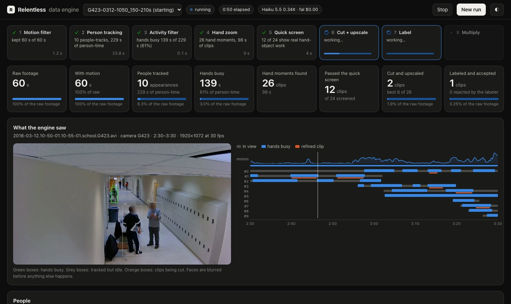

# Relentless engine

Turns raw CCTV footage into short, upscaled, labeled clips of hands working on objects, with
lineage back to the source and optional generated variants. It runs on a Mac (Apple Silicon);
only labeling, screening and variants call out to an API.

```
raw video
  1. motion filter     drop the parts where nothing moves                         local, about 60x real time
  2. person tracking   everyone followed, one number per person, faces located    local, 2-3x real time
  3. activity filter   keep the parts where a person's hands are busy             local, seconds
  4. hand zoom         a 2-8 s, 16:9 crop around each burst of hand activity      local, instant
  5. quick screen      Claude rates contact sheets, weak candidates are dropped   API, under 0.01 cents each
  6. cut + upscale     hands located, faces blurred, clip cut, 4x super-resolution   local, 6-15 s per clip
  7. label             Claude writes the label card, rejects non-interactions     API, about 0.2 cents per clip
  8. multiply          object-swap variants, labels carried over, each checked    API, about 11 cents per 4 s variant
```

Each stage throws away most of what it gets before the next, more expensive stage runs. The
Claude stages run on Haiku 5.5 (see [Which Claude model](#which-claude-model)).

## Setup

```sh
cd engine && uv sync
```

Keys go in the repo root `.env` (git-ignored): `ANTHROPIC_API_KEY`, `FAL_KEY`. On a server they
can come from the environment instead, as `RELENTLESS_ANTHROPIC_API_KEY` and `RELENTLESS_FAL_KEY`.
Model weights (pose model, whole-body model, upscaler) download into `engine/models/` on first use,
about 260 MB on a machine with a GPU and 160 MB without.

## Run it

**Dashboard** (the demo surface):

```sh
uv run python -m relentless.serve --open      # http://127.0.0.1:8765
```

Press **New run**, pick a raw clip, a start time and a length, and watch the stages, the funnel
numbers and the clips fill in. Past runs stay in the run menu. Add `--host 0.0.0.0` to let
teammates on the same network watch. `?run=<name>&clip=c003` in the address opens a run at one clip.




**Command line** (same pipeline, same output):

```sh
uv run python -m relentless.pipeline ../data/raw/meva/2018-03-07.17-30-00.17-35-00.school.G421.avi \
    --start 60 --seconds 90 --max-clips 8 --fast
```

| Flag | What it does |
|---|---|
| `--start`, `--seconds` | Which part of the video to process (default: all of it). |
| `--max-clips N` | Refine at most N hand clips (default 12, `0` = every candidate that passes the screen). This is the main cost and time control. |
| `--fast` | Cap upscaled clips at 720p instead of 1080p. About twice as fast. |
| `--multiply N` | Make an object-swap variant for N accepted clips. Uses fal credits. |
| `--variants M` | Swaps per multiplied clip (default 1). |
| `--no-screen` | Skip the quick screen and pick clips by motion score alone. |
| `--no-label` | Stop after upscaling. No API calls at all. |
| `--no-cache` | Redo tracking, screening, labeling and variants even if cached (see below). |
| `--effort` | Claude effort for labeling: `low`, `medium` (default), `high`. |
| `--live` | Also write previews of what each stage is looking at into the run's `live/` folder. The website's job page shows them; jobs started from it always use this. |

A 60 s window with 8 clips takes about 2 minutes on an M1 Pro and costs about 2 cents of Claude.

## What a run produces

Everything lands in `data/runs/<name>/`:

```
state.json            live state: stages, funnel, people, clips, labels, costs (the dashboard reads this)
overview.mp4          the whole frame, small, with tracked people, busy hands and clip boxes drawn in
people/p012.mp4       preview that follows one person through their busiest stretch
clips/c003/
    raw.mp4           the hand crop at source resolution (faces blurred)
    upscaled.mp4      the same clip at 4x
    compare.mp4       raw pixels next to upscaled
    context.mp4       wider crop around the whole person, with the zoom area outlined
    hands.json        per-frame box of the left and the right hand, normalised to the crop, with a flag for
                      the frames in which the hand is located at all (see "Hand tracks" below)
    card.json         the label card: caption, objects, timed action segments, quality, lineage
    poster.jpg        one still from the upscaled clip, for catalog pages
    variants/         original.mp4 (the window sent to the edit model), each variant .mp4 + .json
catalog.json          the sellable items from this run: accepted originals and verified variants
run.log               console output, for runs started from the dashboard
live/                 only with --live: what the website's job page shows of each stage
    now.json          the frame a running stage is on (motion filter, person tracking), a few times a second
    scan.mp4          the whole stretch, small, at 5 frames a second
    preview.mp4       the busiest 14 seconds at full frame rate; tracks.json has everyone's box, joints and located hands in it
    cands.jpg         one still per hand moment, tiled; screen.jpg: the stills the quick screen showed Claude
    kit.json          which of these exist, and how to read them
```

`card.json` records where the clip came from: source file, frame range, crop box, person track,
which hand was busy, the models used. Any label can be traced back to the full scene.

Faces are blurred in every preview by the rule the outputs use: every head the pose model found,
and where a person was between two sightings a moment apart. For the frame person tracking is on,
that rule needs the samples after the frame too, so the frame shown is the one from six samples
(0.6 s of footage) ago. The one picture made before any face has been located, the motion
filter's, shows the frame at 64 pixels across, which is too coarse for a face. `uv run python -m relentless.live data/runs/NAME` writes the previews for a run that was
made without `--live` (from the tracking cache, in one pass over the source).

The website reads each run's `catalog.json` on its own (see `backend/library.py` in the repo
root). A run started from the site's admin console joins the catalog when it is published there;
a run made by hand in the site's data folder joins it as soon as it ends. To collect runs by
hand, or to add them to the seed library that is committed with the site:

```sh
uv run python -m relentless.catalog                            # data/catalog.json: every run, duplicates removed
uv run python -m relentless.catalog --export DIR               # self-contained folder: files + catalog.json
uv run python -m relentless.catalog --export ../data/library --web   # the site's seed library: small streaming copies
```

Each catalog item carries the pricing tiers it qualifies for: `bulk` (every accepted clip),
`labeled+` (quality 6 or more, at least two action segments, hand tracks), `studio` (has a
verified variant).

## How each stage decides

| Stage | Signal | Main thresholds (in the stage's config dataclass) |
|---|---|---|
| Motion (`motion.py`) | Share of pixels that changed between samples of a 480 px wide frame, 10 times a second. | `min_fraction` 0.035% of pixels, spans padded by 1 s and merged across gaps under 2 s. |
| People (`people.py`) | YOLO26 pose model at 1280 px on 10 frames per second, linked by ByteTrack. The tracks of someone the tracker lost (behind a counter, behind a passer-by) are then joined into one person by position, size and the colour of their clothes. | Drops appearances under 1.5 s or under 110 px tall. Gaps up to 1 s are interpolated. Tracks are joined across gaps up to 3 s, or up to 20 s for someone back in the same spot in the same clothes; never when someone else stood there meanwhile or two continuations are equally likely. |
| Activity (`activity.py`) | Wrist speed relative to the body, in torso lengths per second, so near and far people are measured alike. Then a sparse look by the whole-body model (about once a second) at every busy stretch. | `hand_speed` 0.4; 2.5 times stricter while the person walks; wrists the model is unsure about count as unseen. A busy stretch in which the person is readable less than 30% of the time is set aside (`unclear` in state.json). |
| Hand zoom (`interactions.py`) | Bursts of wrist motion with the hand raised above the hips or reaching out from the body. | Clips of 2-8 s; crop = hand path plus 0.6 torso lengths of margin, widened to 16:9; skips people with a torso under 38 px. |
| Screen (`screen.py`) | Claude rates four frames per candidate, six candidates per image, 0-3. | Rated 0 is dropped. The `4 x max-clips` most active candidates are screened. |
| Second look (`hands.py`, `wholebody.py`) | A whole-body pose model (RTMW) on each chosen person, cut out of the frame and enlarged: body joints and 21 keypoints per hand, 10 times a second. | A hand is located where its keypoints are confident, sit together and hang on their wrist, at the end of an arm the model can read, for more than 0.3 s. A moment whose person cannot be read for three quarters of it, or in which no hand is located, is dropped and the next best takes its place. |
| Upscale (`upscale.py`) | Real-ESRGAN `realesr-general-x4v3`, then a blend over time wherever the input did not change. | Output capped at 1080p (720p with `--fast`). |
| Label (`label.py`) | Claude sees 6-12 time-stamped frames plus a context frame and returns a typed card. | Accepted if a hand visibly handles an object and quality is 4 or more. |
| Multiply (`multiply.py`) | A plan first (is the object a loose item the hand holds, and what of the same kind could stand in for it), then the fal video edit (Gemini Omni Flash), labels copied with the swapped object renamed, then Claude compares variant and original and the hand positions are measured. | Only clips with label quality 5 or more whose plan says yes. A variant passes if the edit is applied, nothing else changed, it makes sense, motion is preserved, hands are intact and where they were, blurred faces stay blurred and the score is 6 or more. |

Faces are blurred once, on the full frame, before any clip is cut, using the head position from
the pose keypoints. Every person the model sees gets a blur, tracked or not, so the upscaler and
the labeler never see a face.

## Hand tracks

The pose model of stage 2 sees the whole frame, where a person is one or two hundred pixels tall. Its
wrists are good enough to notice that hands are busy; they are not good enough to draw. A wrist in a
dark sleeve against a dark coat lands anywhere along the arm, and on foggy night footage the whole
skeleton is a guess. So once the engine has chosen its moments, it looks at those people again with a
whole-body model, one person at a time, and takes the skeleton and both hands from that.

`hands.json` has, for every frame of the clip and for each hand: `x`, `y` (the centre of the hand's box),
`w`, `h` (its size), `conf` (0-1) and `seen`. Where `seen` is false the hand is not located in that frame
(hidden, out of view, too unclear) and the numbers are only the nearest place it was located: do not draw
or train on them. `busy` names the hand or hands that work in the clip.

What it changes, measured on clips from the cafe, the hallway and the night-time truck footage:

- The old box was a fixed square, half a torso wide, at the wrist plus a third of the forearm. Against
  the new tracks (73 clips with a readable person, 16,345 frames), the hand was outside it in 9.6% of
  the frames, and in more than a quarter of the frames in 13 of the 73 clips: on the coat, on the
  forearm, or on the other hand. The new box is on the hand in every frame checked by eye, and it is
  the size of the hand (the old square was about twice as wide).
- A hand is drawn only where it is located. On the truck footage, the worker who is a blur next to the
  lens gets no hand boxes and no skeleton (the job page marks them "unclear"); the worker who can be
  seen gets a box on each glove.
- The labeler sees a thin L / R mark around each located hand on its frames, so `hand` in a label is the
  tracked hand, not a guess: 109 of the 110 action segments in the 26 clips labeled since then say left,
  right or both. On the full cafe clip it is 55 of 56, where the same model named the hand in 20 of 54.
- Moments in which no hand can be located are replaced by the next best ones before anything is cut.
  Of 83 clips of earlier runs put through it, 76 stay; the 7 that go are all of the one worker on the
  truck footage whom no model could read. An arm is judged on its own, so a person at the edge of the
  frame, or with one arm behind the body, keeps the hand that is in plain view.

It costs 15 to 35 s per run on an M1 Pro (16 ms per person and sample on the Apple GPU). Without a GPU
the smaller model is used (about 35 ms on four CPU threads); it puts the hands in the same places.
`WHOLEBODY=off` in `.env` turns the second look off: hand tracks are then the old estimate from the
wrist, marked as such in `hands.json`.

The confidence scale was set by looking: 4,266 hand predictions in bins of the model's score, a sample
of each bin checked by eye. Under a score of 2 a hand box was right about one time in six, between 2.5
and 3 about four in five, above 4.5 every time; 0.5 on the engine's scale is a score of 2.8.

## Measured on the MEVA clips

Against MEVA's human labels (pick-up, put-down and hand-over events). "Footage" is counted in
pixel-seconds of the raw window, so it means the same for a full frame and a hand crop.

| Footage | Events | Activity filter | Hand zoom (every moment found) |
|---|---|---|---|
| Café counter G421, full 5 min, 12 people in view | 87 | 77 kept (89%) in 14% of the footage | 66 kept (76%) in 24% of the footage |
| Hallway snack table G423, first 2 min | 23 | 23 kept in 2.6% of the footage | 23 kept in 5.4% of the footage |

Hand-zoom crops are 16:9 and leave room for the object, which is why they cover more pixels than
the person boxes the activity filter keeps. On the café clip the 12 refined clips are under 2% of
the raw footage. That run takes about 7 minutes on an M1 Pro: tracking 1 min 49 s, cutting and
upscaling 12 clips to 1080p 3 min 35 s, one variant 1 min 25 s. It costs 2.2 cents of Claude
(12 labels, 8 screening sheets, one variant check) plus 11 cents of fal per variant.

Every run on a MEVA clip repeats this check for its own window and shows it in the dashboard
("Checked against human labels").

Upscaling, measured on one clip: static areas flicker 40% less with the blend over time than
frame-by-frame output, and edges on the moving hand are 23% stronger than plain bicubic.

## Costs and guards

- Every paid call is appended to `data/spend-ledger.jsonl` with its purpose and cost.
- fal calls stop at a total cap: `FAL_BUDGET_USD` in `.env` (default 3.00). Parallel variant jobs
  reserve their cost first, so they cannot overshoot it together.
- `--max-clips` bounds Claude spend per run: about 0.2 cents per refined clip plus about 0.04 cents
  per six screened candidates. The dashboard's estimate uses the ledger's average for the model in use.
- A variant is only asked for after the planner has said the clip is fit for one (about 0.1 cents per
  clip looked at, at most four clips per variant wanted). Most clips are not: of 52 labeled clips the
  planner was tried on, it approved 5 (cups, a backpack, a phone), all among the 24 with quality 5.
  The usual reasons for a no: the object is too small or blurred to replace cleanly (27), the hand
  touches it without holding it (12), it cannot be made out at all (5).

## Which Claude model

Screening, labeling and the variant check run on `claude-haiku-5-5`. To use another model, set
`CLAUDE_MODEL` in `.env` (all three stages) or `SCREEN_MODEL` (screening only), for example
`CLAUDE_MODEL=claude-opus-5-5`. Each run records the model it used, and cached results are kept
per model.

The engine started on Opus 5.5 and moved to Haiku 5.5 for cost. Both models were run on the same
inputs: the 26 clips Opus had labeled, the 104 candidates it had screened and 6 generated variants.

| | Haiku 5.5 | Opus 5.5 |
|---|---|---|
| Cost per label | 0.21 cents | 6.3 cents |
| Cost per screening sheet (six candidates) | 0.04 cents | 1.5 cents |
| Cost per variant check | 0.07 cents | 2.4 cents |
| Clips accepted, of 26 | 26 | 26 |
| Quality scores given | 4 and 5 | 4, 5 and 6 |
| Clips reaching the Labeled+ bar (quality 6) | 0 | 3 |
| Action segments that say which hand (before the frames carried L / R marks) | about 4 in 10 | about 7 in 10 |
| Label names the same action as MEVA's human label, of 11 events | 7 to 8 | 10 |
| Screening: same keep-or-drop decision as Opus | 90% of candidates | |
| Variant check: un-blurred face caught | every time | noted, before the rule existed |

What that means in practice:

- **Labels are a little less exact.** Haiku agrees with the human annotation less often, mostly on
  put-downs. When the comparison was made it also said "unknown" for the hand more often; since the
  labeler's frames carry the L / R marks of the located hands, it names the hand in nearly every segment
  (see "Hand tracks").
- **Labeled+ is empty on Haiku.** Its quality score never reached 6 at the default effort, so the
  tier rule in `pipeline.tiers` needs a new bar if that tier is to be filled. Object swaps had the same
  problem and now have their own bar: label quality 5, Haiku's top mark.
- **Screening keeps slightly more.** Where the two disagree, Haiku usually lets through something
  Opus dropped, such as a person taking off a jacket. The labeler sees those clips next.
- **The variant check is noisy near the pass mark on either model.** Haiku passed one variant with
  a discoloured table three times out of four. Opus rejected it twice and passed it once. A
  variant that passes one check is not guaranteed to be clean.

`--effort high` on Haiku costs about 30% more per label and did not give steadier results in two
passes over the 26 clips.

## As a worker for the website

The site's admin console (`/admin`) can queue a job for a worker instead of running it on the web
server. A worker is this engine on any machine, started with the site's address:

```sh
uv run python -m relentless.worker https://peelset.com
```

It asks the site for jobs, downloads the footage into `data/uploads/`, runs the pipeline here
with `--live`, and sends the finished clips back, where they wait on the job's page to be
published. While the run goes on it keeps the site's copy of the run up to date about once a
second: the state, the frame a stage is on, and each preview and clip as it is finished (a clip
goes as a small copy; the full one travels once, at the end). That is what the job page shows.
The admin token comes from `--token` or from `PEELSET_ADMIN_TOKEN` in `.env`. The run also stays
in `data/runs/` on the worker, so the dashboard shows it. `--once` exits after one job.

A job can ask for object-swap variants (`--multiply`). They are made with this machine's
`FAL_KEY`, within its `FAL_BUDGET_USD`; the worker tells the site whether it has a key and how
much of the budget is used, and the console only offers variants when it does. Asking for variants
does not mean getting them: a job whose clips are not fit for a swap ends with none, and the job page
says why for each clip that was looked at.

## On a server, without a GPU

The site's Docker image installs the engine with CPU-only PyTorch, and the admin page (`/admin`)
starts it as a background job on an uploaded video. Seven settings adapt it, as environment
variables or in `.env` without the prefix:

| Setting | What it does |
|---|---|
| `RELENTLESS_DATA` | Where runs, uploads, the cache and the spend ledger go (default: `data/` in the repo). |
| `RELENTLESS_DEVICE` | `cpu`, `mps` or `cuda`. Default: the best one available. |
| `RELENTLESS_THREADS` | Caps the CPU threads torch, OpenCV and the video encoder use, so a shared server keeps room for its other work. |
| `RELENTLESS_POSE_IMGSZ` | Input size of the pose model (default 1280). 960 is about a third faster and misses some small, distant people. |
| `RELENTLESS_POSE_BATCH` | Frames per pose-model call (default 8). A smaller number needs less memory. |
| `RELENTLESS_LOW_MEMORY` | Set to 1 to run person tracking and the second look each in a child process that exits before upscaling starts, so no two models are in memory together. |
| `RELENTLESS_WHOLEBODY` | The model of the second look: `x` (384x288, the default with a GPU), `m` (256x192, the default without one) or `off`. |

Measured on four CPU threads of an M1 Pro: person tracking 117 ms per frame at 960 (182 ms at
1280, against 31 ms on the Apple GPU), the second look 35 ms per person and sample (95 ms on two
threads, where it peaks at 470 MB in a process of its own), upscaling 3.8 frames per second to 720p
and 1.9 to 1080p. A 4 s clip therefore takes about half a minute to upscale to 720p, where the GPU
needs 5 s.

## Caching

Tracking, screening, labels, swap plans and variants are cached in `data/cache/`, keyed by the source
file, the window, the settings and the model. Running the same window again redoes the local work (cutting,
upscaling) but pays nothing. That makes rehearsals free and gives the live demo a fallback: if
the network drops, a window you ran before still completes. `--no-cache` forces everything fresh.

## Tests

```sh
uv run pytest
```

The tests cover the stage logic on synthetic people (no video, models or API needed), the
dashboard server's file serving, how requests are priced and sent for each Claude model, the
previews for the website's job page (what they hold, that every head in them is blurred, how a
worker keeps the site's copy up to date), the second look (what counts as a located hand, how a
track is cleaned over time, how a clip's busy hand, crop and `hands.json` follow from it, that an
unlocatable moment is replaced), and object swaps (which clips are fit, what a variant must hold up
to, and that a fixed handle is never sent to the edit model).

## Multiply on its own

```sh
uv run python -m relentless.multiply CLIP --card card.json --variants swap --swap "paper cup=apple" --dry-run
```

Presets: `evening`, `fluorescent`, `store`, `clothing`, `swap`. `--dry-run` prints the cost and
exits. Object swaps hold up better than whole-scene edits, which is why the pipeline only swaps.

In the pipeline a swap is not taken from the label. The first variants were: the label named an
object, the labeler suggested "everyday objects of similar size", the best-scoring clips were sent
off. On foggy footage of a refuse truck that turned a collector's grip on the grab handle (labeled
"a crumpled yellow-white packet") into a hand holding a bag of crisps, and the check passed it. Now:

- A clip is a candidate only if its label has quality 5 or more, names its object, has the object in
  a hand (picked up, held, carried, set down) for a fifth of the clip, and the working hand is located.
- The planner (`multiply.plan_swap`) then looks at the frames of the stretch that would be edited and
  says what the hand is handling, whether it is a loose item, whether the hand holds it, whether it can
  be made out, and what of the same kind could replace it here. Each answer is checked on its own
  (`multiply.fit`); the truck clips fail on the first one.
- The check has two more questions (did anything else change, does the result make sense), and one
  measurement: the hands of the variant are located and compared with the clip's hand track. A variant
  whose hands are not where they were does not pass, whatever the checker thought of it.

## Known limits

- The motion-based stages find hand activity, not objects. The screen and the labeler decide
  whether an object is really involved, so those two stages need the API.
- Left and right come from the whole-body model's reading of the body. On the clips checked it did not
  swap them from one sample to the next, but a person seen from straight above or mostly hidden can
  still be read the wrong way round.
- When one hand is hidden behind the other or behind an object, the model often places both on the
  same spot. The box is then on a hand, but it stands for two.
- The activity filter measures stage 2's wrists. Where the whole-body model cannot read the person
  (fog, glare, someone next to the lens) those stretches are set aside; a person it reads only half the
  time keeps theirs, and the second look then drops the moments in which no hand is located.
- Joining tracks into people is cautious: when unsure it leaves two numbers rather than risk one number
  for two people. On the 5-minute café clip 127 tracks became 101 people; staff who stand behind the
  counter, hidden for many seconds at a time, can still have a few numbers.
- People smaller than about 110 px tall are skipped: their hands are only a few pixels wide.
- The pose model (Ultralytics YOLO26) is AGPL-3.0, which matters if the engine itself is ever distributed.
  The whole-body model (RTMW, OpenMMLab) and its runtime (ONNX Runtime) are Apache-2.0 and MIT.
