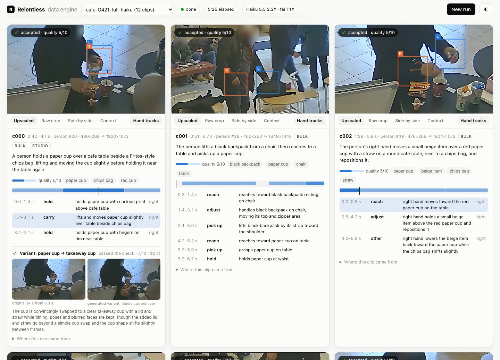

# Relentless engine

Turns raw CCTV footage into short, upscaled, labeled clips of hands working on objects, with
lineage back to the source and optional generated variants. It runs on a Mac (Apple Silicon);
only labeling, screening and variants call out to an API.

```
raw video
  1. motion filter     drop the parts where nothing moves                         local, about 60x real time
  2. person tracking   one track per person-appearance, faces located             local, 2-3x real time
  3. activity filter   keep the parts where a person's hands are busy             local, instant
  4. hand zoom         a 2-8 s, 16:9 crop around each burst of hand activity      local, instant
  5. quick screen      Claude rates contact sheets, weak candidates are dropped   API, under 0.01 cents each
  6. cut + upscale     faces blurred, clip cut, 4x super-resolution               local, 5-13 s per clip
  7. label             Claude writes the label card, rejects non-interactions     API, about 0.2 cents per clip
  8. multiply          object-swap variants, labels carried over, each checked    API, about 11 cents per 4 s variant
```

Each stage throws away most of what it gets before the next, more expensive stage runs. The
Claude stages run on Haiku 5.5 (see [Which Claude model](#which-claude-model)).

## Setup

```sh
cd engine && uv sync
```

Keys go in the repo root `.env` (git-ignored): `ANTHROPIC_API_KEY`, `FAL_KEY`. On a server they
can come from the environment instead, as `RELENTLESS_ANTHROPIC_API_KEY` and `RELENTLESS_FAL_KEY`.
Model weights (pose model, upscaler) download into `engine/models/` on first use, about 30 MB.

## Run it

**Dashboard** (the demo surface):

```sh
uv run python -m relentless.serve --open      # http://127.0.0.1:8765
```

Press **New run**, pick a raw clip, a start time and a length, and watch the stages, the funnel
numbers and the clips fill in. Past runs stay in the run menu. Add `--host 0.0.0.0` to let
teammates on the same network watch. `?run=<name>&clip=c003` in the address opens a run at one clip.




**Command line** (same pipeline, same output):

```sh
uv run python -m relentless.pipeline ../data/raw/meva/2018-03-07.17-30-00.17-35-00.school.G421.avi \
    --start 60 --seconds 90 --max-clips 8 --fast
```

| Flag | What it does |
|---|---|
| `--start`, `--seconds` | Which part of the video to process (default: all of it). |
| `--max-clips N` | Refine at most N hand clips (default 12, `0` = every candidate that passes the screen). This is the main cost and time control. |
| `--fast` | Cap upscaled clips at 720p instead of 1080p. About twice as fast. |
| `--multiply N` | Make an object-swap variant for N accepted clips. Uses fal credits. |
| `--variants M` | Swaps per multiplied clip (default 1). |
| `--no-screen` | Skip the quick screen and pick clips by motion score alone. |
| `--no-label` | Stop after upscaling. No API calls at all. |
| `--no-cache` | Redo tracking, screening, labeling and variants even if cached (see below). |
| `--effort` | Claude effort for labeling: `low`, `medium` (default), `high`. |

A 60 s window with 8 clips takes about 2 minutes on an M1 Pro and costs about 2 cents of Claude.

## What a run produces

Everything lands in `data/runs/<name>/`:

```
state.json            live state: stages, funnel, people, clips, labels, costs (the dashboard reads this)
overview.mp4          the whole frame, small, with tracked people, busy hands and clip boxes drawn in
people/p012.mp4       preview that follows one person through their busiest stretch
clips/c003/
    raw.mp4           the hand crop at source resolution (faces blurred)
    upscaled.mp4      the same clip at 4x
    compare.mp4       raw pixels next to upscaled
    context.mp4       wider crop around the whole person, with the zoom area outlined
    hands.json        per-frame left/right hand positions, normalised to the crop (from body pose)
    card.json         the label card: caption, objects, timed action segments, quality, lineage
    poster.jpg        one still from the upscaled clip, for catalog pages
    variants/         original.mp4 (the window sent to the edit model), each variant .mp4 + .json
catalog.json          the sellable items from this run: accepted originals and verified variants
run.log               console output, for runs started from the dashboard
```

`card.json` records where the clip came from: source file, frame range, crop box, person track,
which hand was busy, the models used. Any label can be traced back to the full scene.

The website reads each run's `catalog.json` on its own (see `backend/library.py` in the repo
root), so clips processed on the machine that serves the site show up in its catalog as soon as
the run ends. To collect runs by hand, or to add them to the seed library that is committed with
the site:

```sh
uv run python -m relentless.catalog                            # data/catalog.json: every run, duplicates removed
uv run python -m relentless.catalog --export DIR               # self-contained folder: files + catalog.json
uv run python -m relentless.catalog --export ../data/library --web   # the site's seed library: small streaming copies
```

Each catalog item carries the pricing tiers it qualifies for: `bulk` (every accepted clip),
`labeled+` (quality 6 or more, at least two action segments, hand tracks), `studio` (has a
verified variant).

## How each stage decides

| Stage | Signal | Main thresholds (in the stage's config dataclass) |
|---|---|---|
| Motion (`motion.py`) | Share of pixels that changed between samples of a 480 px wide frame, 10 times a second. | `min_fraction` 0.035% of pixels, spans padded by 1 s and merged across gaps under 2 s. |
| People (`people.py`) | YOLO26 pose model at 1280 px on 10 frames per second, linked by ByteTrack. | Drops appearances under 1.5 s or under 110 px tall. Gaps up to 1 s are interpolated. |
| Activity (`activity.py`) | Wrist speed relative to the body, in torso lengths per second, so near and far people are measured alike. | `hand_speed` 0.4; 2.5 times stricter while the person walks; wrists the model is unsure about count as unseen. |
| Hand zoom (`interactions.py`) | Bursts of wrist motion with the hand raised above the hips or reaching out from the body. | Clips of 2-8 s; crop = hand path plus 0.6 torso lengths of margin, widened to 16:9; skips people with a torso under 38 px. |
| Screen (`screen.py`) | Claude rates four frames per candidate, six candidates per image, 0-3. | Rated 0 is dropped. The `4 x max-clips` most active candidates are screened. |
| Upscale (`upscale.py`) | Real-ESRGAN `realesr-general-x4v3`, then a blend over time wherever the input did not change. | Output capped at 1080p (720p with `--fast`). |
| Label (`label.py`) | Claude sees 6-12 time-stamped frames plus a context frame and returns a typed card. | Accepted if a hand visibly handles an object and quality is 4 or more. |
| Multiply (`multiply.py`) | fal video edit (Gemini Omni Flash), labels copied with the swapped object renamed, then Claude compares variant and original. | Passes if the edit is applied, motion is preserved, hands are intact, blurred faces stay blurred and the score is 6 or more. |

Faces are blurred once, on the full frame, before any clip is cut, using the head position from
the pose keypoints. Every person the model sees gets a blur, tracked or not, so the upscaler and
the labeler never see a face.

## Measured on the MEVA clips

Against MEVA's human labels (pick-up, put-down and hand-over events). "Footage" is counted in
pixel-seconds of the raw window, so it means the same for a full frame and a hand crop.

| Footage | Events | Activity filter | Hand zoom (every moment found) |
|---|---|---|---|
| Café counter G421, full 5 min, 12 people in view | 87 | 77 kept (89%) in 14% of the footage | 66 kept (76%) in 24% of the footage |
| Hallway snack table G423, first 2 min | 23 | 23 kept in 2.6% of the footage | 23 kept in 5.4% of the footage |

Hand-zoom crops are 16:9 and leave room for the object, which is why they cover more pixels than
the person boxes the activity filter keeps. On the café clip the 12 refined clips are under 2% of
the raw footage. That run takes about 7 minutes on an M1 Pro: tracking 1 min 49 s, cutting and
upscaling 12 clips to 1080p 3 min 35 s, one variant 1 min 25 s. It costs 2.2 cents of Claude
(12 labels, 8 screening sheets, one variant check) plus 11 cents of fal per variant.

Every run on a MEVA clip repeats this check for its own window and shows it in the dashboard
("Checked against human labels").

Upscaling, measured on one clip: static areas flicker 40% less with the blend over time than
frame-by-frame output, and edges on the moving hand are 23% stronger than plain bicubic.

## Costs and guards

- Every paid call is appended to `data/spend-ledger.jsonl` with its purpose and cost.
- fal calls stop at a total cap: `FAL_BUDGET_USD` in `.env` (default 3.00). Parallel variant jobs
  reserve their cost first, so they cannot overshoot it together.
- `--max-clips` bounds Claude spend per run: about 0.2 cents per refined clip plus about 0.04 cents
  per six screened candidates. The dashboard's estimate uses the ledger's average for the model in use.

## Which Claude model

Screening, labeling and the variant check run on `claude-haiku-5-5`. To use another model, set
`CLAUDE_MODEL` in `.env` (all three stages) or `SCREEN_MODEL` (screening only), for example
`CLAUDE_MODEL=claude-opus-5-5`. Each run records the model it used, and cached results are kept
per model.

The engine started on Opus 5.5 and moved to Haiku 5.5 for cost. Both models were run on the same
inputs: the 26 clips Opus had labeled, the 104 candidates it had screened and 6 generated variants.

| | Haiku 5.5 | Opus 5.5 |
|---|---|---|
| Cost per label | 0.21 cents | 6.3 cents |
| Cost per screening sheet (six candidates) | 0.04 cents | 1.5 cents |
| Cost per variant check | 0.07 cents | 2.4 cents |
| Clips accepted, of 26 | 26 | 26 |
| Quality scores given | 4 and 5 | 4, 5 and 6 |
| Clips reaching the Labeled+ bar (quality 6) | 0 | 3 |
| Action segments that say which hand | about 4 in 10 | about 7 in 10 |
| Label names the same action as MEVA's human label, of 11 events | 7 to 8 | 10 |
| Screening: same keep-or-drop decision as Opus | 90% of candidates | |
| Variant check: un-blurred face caught | every time | noted, before the rule existed |

What that means in practice:

- **Labels are a little less exact.** Haiku agrees with the human annotation less often, mostly on
  put-downs, and it says "unknown" for the hand more often. Hand side is still in `hands.json`,
  which comes from the pose model.
- **Labeled+ is empty on Haiku.** Its quality score never reached 6 at the default effort, so the
  tier rule in `pipeline.tiers` needs a new bar if that tier is to be filled.
- **Screening keeps slightly more.** Where the two disagree, Haiku usually lets through something
  Opus dropped, such as a person taking off a jacket. The labeler sees those clips next.
- **The variant check is noisy near the pass mark on either model.** Haiku passed one variant with
  a discoloured table three times out of four. Opus rejected it twice and passed it once. A
  variant that passes one check is not guaranteed to be clean.

`--effort high` on Haiku costs about 30% more per label and did not give steadier results in two
passes over the 26 clips.

## On a server, without a GPU

The site's Docker image installs the engine with CPU-only PyTorch, and the admin page (`/admin`)
starts it as a background job on an uploaded video. Four settings adapt it, as environment
variables or in `.env` without the prefix:

| Setting | What it does |
|---|---|
| `RELENTLESS_DATA` | Where runs, uploads, the cache and the spend ledger go (default: `data/` in the repo). |
| `RELENTLESS_DEVICE` | `cpu`, `mps` or `cuda`. Default: the best one available. |
| `RELENTLESS_THREADS` | Caps the CPU threads torch and OpenCV use, so a shared server keeps room for its other work. |
| `RELENTLESS_POSE_IMGSZ` | Input size of the pose model (default 1280). 960 is about a third faster and misses some small, distant people. |

Measured on four CPU threads of an M1 Pro: person tracking 117 ms per frame at 960 (182 ms at
1280, against 31 ms on the Apple GPU), upscaling 3.8 frames per second to 720p and 1.9 to 1080p.
A 4 s clip therefore takes about half a minute to upscale to 720p, where the GPU needs 5 s.

## Caching

Tracking, screening, labels and variants are cached in `data/cache/`, keyed by the source file,
the window, the settings and the model. Running the same window again redoes the local work (cutting,
upscaling) but pays nothing. That makes rehearsals free and gives the live demo a fallback: if
the network drops, a window you ran before still completes. `--no-cache` forces everything fresh.

## Tests

```sh
uv run pytest
```

The tests cover the stage logic on synthetic people (no video, models or API needed), the
dashboard server's file serving, and how requests are priced and sent for each Claude model.

## Multiply on its own

```sh
uv run python -m relentless.multiply CLIP --card card.json --variants swap --swap "paper cup=apple" --dry-run
```

Presets: `evening`, `fluorescent`, `store`, `clothing`, `swap`. `--dry-run` prints the cost and
exits. Object swaps hold up better than whole-scene edits, which is why the pipeline only swaps.

## Known limits

- The motion-based stages find hand activity, not objects. The screen and the labeler decide
  whether an object is really involved, so those two stages need the API.
- Left and right hand come from the pose model and can be wrong when a person is seen from behind.
- Hand tracks are estimates from the wrist and forearm, not a hand detector.
- People smaller than about 110 px tall are skipped: their hands are only a few pixels wide.
- The pose model (Ultralytics YOLO26) is AGPL-3.0, which matters if the engine itself is ever distributed.
